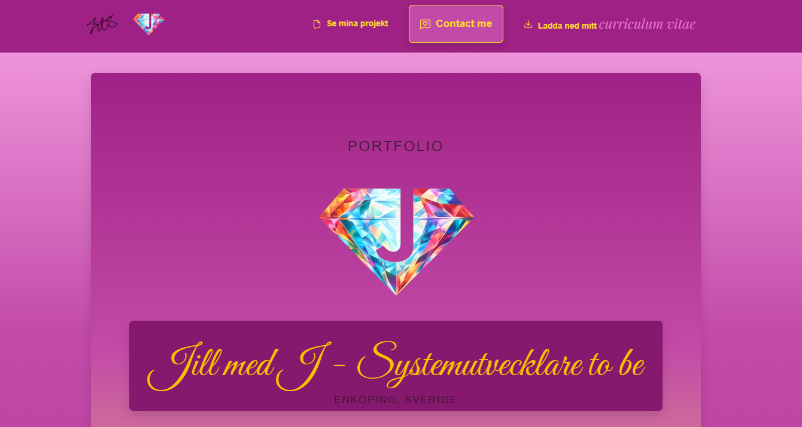

# Jill med J – Min portfolio

[Se portfolion live](https://jillmedj.github.io/JillmedJ_Portfolio/)

<!-- Skärmbild av portfolions startsida (hero-sektionen) -->
<!-- ! = bild, [ ] = alt-text för skärmläsare, ( ) = relativ sökväg från README.md -->


Jag byggde portfolion under utbildningen Systemutvecklare .NET, som en inlämningsuppgift i kursen Dynamiska webbapplikationer. Uppgiften gav mig också något mer: ett naturligt forum för Jill med J som konstnär. Det tyckte jag var väldigt roligt och spännande.

## Innehåll
- Navbar med min egen logga och mitt nedladdningsbara CV
- CTA:er som leder vidare på sidan
- Hero
- About Me
- My Projects: ett bildspel med mina projekt
- Vad andra säger: ett bildspel med testimonials
- Kontaktformulär med HTML5-validering, kopplat till min mejl via Formspree
- Footer med länkar

## Teknik och principer
- **HTML5** med semantiska taggar (`header`, `nav`, `main`, `section`, `article`, `footer`)
- **CSS3**, komponentbaserad och byggd på **tokens** för färger, spacing, typografi, borders och lager
- **Mobile first** och responsiv design med Flexbox och CSS Grid
- **JavaScript** för bildspelet med testimonials: pilar, pagineringsprickar, swipe på mobil, automatisk växling och paus vid hover
- **Tillgänglighet:** alt-texter, aria-attribut och semantisk struktur
- **Git och GitHub** för versionshantering, publicerad med GitHub Pages

## Så har jag testat
Jag har testat manuellt:
- navigation och länkar
- kontaktformuläret (HTML5-validering, obligatoriska fält och e-postformat)
- responsivitet på mobil och desktop
- nedladdning av CV
- att inga fel syns i konsolen

## Så kör du projektet
Projektet är byggt i ren HTML, CSS och JavaScript. Ingen installation krävs.
1. Klona eller ladda ned projektet.
2. Öppna projektmappen.
3. Öppna `index.html` i valfri webbläsare.

## Projektstruktur
```text
/css             styles.css samlar allt: tokens, globala stilar och komponenter
/cv              mitt CV som PDF
/documentation   förklaringar av CSS-arkitekturen
/js              index.js med bildspel och formulär
/projects
/visuals         ikoner, bilder och logga
index.html
README.md
```

## Det här arbetar jag med
Jag arbetar aktivt med att:
- skriva semantisk och lättläst kod
- använda tokens för färger, spacing och borders
- bygga återanvändbara komponenter
- förstå varför saker fungerar, inte bara hur

## Nästa steg
Jag vill vidareutveckla:
- projektdelen: byta ut platshållarna mot pågående och färdiga projekt
- tillgängligheten, till exempel att bildspelen går att pausa och stoppa (WCAG 2.2.2)
- responsiviteten
- spacingen
- laddningstiden
- My Skills
- en engelsk version av sidan
- en toggle för att byta färgtema

<details>
<summary>🇬🇧 In English</summary>

# Jill with a J – My portfolio

[See the portfolio live](https://jillmedj.github.io/JillmedJ_Portfolio/)

<!-- Screenshot of the portfolio's start page (the hero section) -->
<!-- ! = image, [ ] = alt text for screen readers, ( ) = relative path from README.md -->


I built this portfolio during my studies in System Development .NET, as an assignment in the course Dynamic Web Applications. The assignment also gave me something more: a natural forum for Jill with a J as an artist. I found that really fun and exciting.

## Contents
- Navbar with my own logo and my downloadable CV
- CTAs that lead further into the page
- Hero
- About Me
- My Projects: a slideshow of my projects
- What others say: a slideshow of testimonials
- Contact form with HTML5 validation, connected to my email through Formspree
- Footer with links

## Tech and principles
- **HTML5** with semantic tags (`header`, `nav`, `main`, `section`, `article`, `footer`)
- **CSS3**, component-based and built on **tokens** for colors, spacing, typography, borders and layers
- **Mobile first** and responsive design with Flexbox and CSS Grid
- **JavaScript** for the testimonial slideshow: arrows, pagination dots, swipe on mobile, auto-rotation and pause on hover
- **Accessibility:** alt texts, aria attributes and semantic structure
- **Git and GitHub** for version control, published with GitHub Pages

## How I have tested
I have tested manually:
- navigation and links
- the contact form (HTML5 validation, required fields and email format)
- responsiveness on mobile and desktop
- CV download
- that no errors show in the console

## How to run the project
The project is built in plain HTML, CSS and JavaScript. No installation needed.
1. Clone or download the project.
2. Open the project folder.
3. Open `index.html` in any browser.

## What I'm working on
I'm actively working on:
- writing semantic and readable code
- using tokens for colors, spacing and borders
- building reusable components
- understanding why things work, not just how

## Next steps
I want to develop:
- the projects section: replacing placeholders with ongoing and finished projects
- accessibility, for example making the slideshows possible to pause and stop (WCAG 2.2.2)
- responsiveness
- spacing
- loading time
- My Skills
- an English version of the site
- a toggle for switching color theme

</details>
